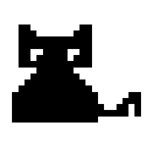

<div align="center">

<div align="center">

<div align="center">
  <pre>
<span style="color: #ADD8E6;">
   ██████╗ ██╗██╗  ██╗███████╗██╗         ██████╗ █████╗ ████████╗
   ██╔══██╗██║╚██╗██╔╝██╔════╝██║        ██╔════╝██╔══██╗╚══██╔══╝
██████╔╝██║ ╚███╔╝ █████╗  ██║        ██║     ███████║   ██║
██╔═══╝ ██║ ██╔██╗ ██╔══╝  ██║        ██║     ██╔══██║   ██║
██║     ██║██╔╝ ██╗███████╗███████╗   ╚██████╗██║  ██║   ██║
╚═╝     ╚═╝╚═╝  ╚═╝╚══════╝╚══════╝    ╚═════╝╚═╝  ╚═╝   ╚═╝
</span>
  </pre>
</div>


<div align="center">
  
</div>


**A tiny, interactive pixel-art companion that lives on top of your desktop.**
It watches your cursor, taps along while you type, and curls up to sleep when you step away.


</div>

<!-- Add a screenshot or demo GIF here, e.g.:
<p align="center"></p>
-->

---

## ✨ Features

| Behaviour | Description |
|---|---|
| 👀 **Cursor tracking** | The cat's eyes follow your mouse pointer anywhere on the screen. |
| ⌨️ **Reacts to typing** | A keyboard pops up and the cat taps its paws alternately as you type, in *any* application. |
| 🖱️ **Draggable** | Click and hold the left mouse button to move the cat anywhere on your desktop. |
| 😴 **Sleep mode** | After 10 seconds without mouse or keyboard activity, the cat lies down with floating "Zzz". Any movement wakes it. |
| 😺 **Natural idle life** | Random blinking keeps the cat feeling alive while it sits. |
| 🪟 **Frameless overlay** | Transparent background, no title bar, always on top of other windows. |
| 🐾 **Custom app icon** | Ships with a multi-size `cat.ico` (16–256 px) used as the application icon. |
| 📋 **Right-click menu** | Quit the app with a right-click. |

---
## 📦 Standalone Executable
```
   ██╗ ██╗      ██████╗    ███╗   ███╗ ███████╗
  ███║███║      ╚════██╗   ████╗ ████║ ██╔═══██
╚██║╚██║       █████╔╝   ██╔████╔██║ ██████
   ██║ ██║      ██╔═══╝    ██║╚██╔╝██║ ██╚═══██
   ██║ ██║  ██  ███████╗   ██║ ╚═╝ ██║ ███████╝
   ╚═╝ ╚═╝      ╚══════╝   ╚═╝     ╚═╝  ╚════╝

 ```
EXE file size: Only 11.2 MB

Platform: Windows

Format: Standalone .exe application


## 🚀 Getting Started

### Prerequisites

- Python **3.8** or newer
- `tkinter` (bundled with the standard Python installer on Windows and macOS)

### Installation

```bash
# 1. Clone the repository
git clone https://github.com/RajeshDev012/desktop-cat.git
cd desktop-cat

# 2. Create a virtual environment
python -m venv venv

# 3. Activate the virtual environment

# Windows (Command Prompt)
venv\Scripts\activate

# Windows (PowerShell)
 .\venv\Scripts\Activate.ps1

# macOS / Linux
 source venv/bin/activate

# 4. Install the dependency
python -m pip install --upgrade pip
pip install pynput

# 5. Run the application (keep cat.ico in the same folder)
python desktop_cat_version1.py
```

### Platform notes

| Platform | Notes |
|---|---|
| **Windows** | Best experience. Full transparency, click-through background and `cat.ico` window icon. |
| **macOS** | Grant **Accessibility** / **Input Monitoring** permission to your Terminal or Python so key presses can be detected. Transparency may vary, and the `.ico` icon is not applied. |
| **Linux** | Requires an X11 session and a compositing window manager for a transparent background. On Debian/Ubuntu install Tk with `sudo apt install python3-tk`. The `.ico` icon is not applied. |

---

## 🎮 Usage

| Action | Result |
|---|---|
| Move the mouse | Cat's eyes follow the pointer |
| Type on the keyboard | Cat taps the keys with its paws |
| Left-click + drag | Move the cat around the screen |
| Stay idle for 10 s | Cat falls asleep |
| Move the mouse or press a key | Cat wakes up |
| Right-click | Open the menu → **Quit** |

---

## ⚙️ Configuration

All settings are constants at the top of `desktop_cat_version1.py`:

| Constant | Default | Description |
|---|---|---|
| `SCALE` | `5` | On-screen size of each pixel. Increase for a bigger cat. |
| `TYPING_TIMEOUT` | `1.2` | Seconds after the last key press before the cat stops typing. |
| `SLEEP_AFTER` | `10` | Seconds of inactivity before the cat falls asleep. |
| `ICON_FILE` | `cat.ico` | Icon file loaded next to the script. |
| `KEY_FACE` / `KEY_BASE` | `#9a9a9a` / `#554545` | Colours of the keyboard keys. |

---

## 🧠 How It Works

- **Procedural pixel art.** The cat is defined as small ASCII grids in code. A white outline is generated automatically around every filled cell, so changing the shape never requires redrawing the outline by hand. No image assets are needed for the cat itself.
- **Flicker-free rendering.** Each frame is rendered once into a single `PhotoImage`, cached by state `(eye direction, blink, typing, paw, sleeping, Z-frame)`, and then swapped in instantly. This keeps dragging smooth and avoids tearing.
- **Global input without logging.** A background `pynput` listener only flags that a key was pressed, to drive the animation. **Keystrokes are never stored, logged, or transmitted.**
- **Transparent overlay.** A frameless, always-on-top Tk window with a colour-key (Windows) or native alpha (macOS) background makes the cat appear to sit directly on the desktop.
- **Bundle-safe icon loading.** `resource_path()` locates `cat.ico` both when running as a script and when packaged into a single `.exe` with PyInstaller.

---

## 📦 Build a Standalone Executable (Windows)

```bash
pip install pyinstaller
pyinstaller --onefile --noconsole --icon cat.ico --add-data "cat.ico;." desktop_cat_version1.py
```

The finished `.exe` appears in the `dist/` folder and carries the cat icon. The cat window itself is frameless, so Windows does not show a taskbar button for it. Use the right-click menu to quit.

---

## 📁 Project Structure

```
desktop-cat/
├── desktop_cat_version1.py   # Application (rendering, animation, input handling)
├── cat.ico                   # Multi-size app icon (16–256 px)
└── README.md
```

---

## 🛣️ Roadmap

- [ ] System tray icon with pause / resume / quit
- [ ] Walking and chasing the cursor
- [ ] Multiple skins (red cat, orange tabby, etc.)
- [ ] Click reactions (purr, jump, stretch)
- [ ] Settings menu for size and sleep time

Ideas and pull requests are welcome.

---

## 🤝 Contributing

1. Fork the repository
2. Create a feature branch: `git checkout -b feature/my-feature`
3. Commit your changes: `git commit -m "Add my feature"`
4. Push the branch: `git push origin feature/my-feature`
5. Open a Pull Request

---

## 📄 License

Distributed under the MIT License. 

---

## 👤 Author

<div align="center">

```text

██████╗  █████╗      ██╗███████╗███████╗██╗  ██╗
██╔══██╗██╔══██╗     ██║██╔════╝██╔════╝██║  ██║
██████╔╝███████║     ██║█████╗  ███████╗███████║
██╔══██╗██╔══██║██   ██║██╔══╝  ╚════██║██╔══██║
██║  ██║██║  ██║╚█████╔╝███████╗███████║██║  ██║
╚═╝  ╚═╝╚═╝  ╚═╝ ╚════╝ ╚══════╝╚══════╝╚═╝  ╚═╝

```

**Rajesh Debnath** ([@RajeshDev012](https://github.com/RajeshDev012))
B.Tech Computer Science & Engineering

[](mailto:deb40067@gmail.com)
[](https://www.linkedin.com/in/rajeshdebnath01/)
[](https://github.com/RajeshDev012)

<div align="center">

⭐ If you like this project, consider giving it a star!

</div>
